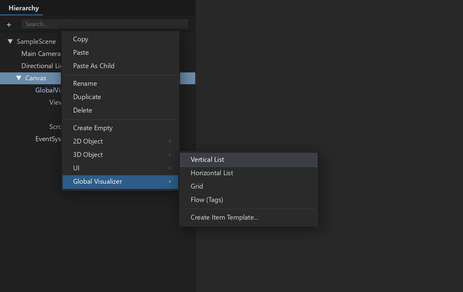
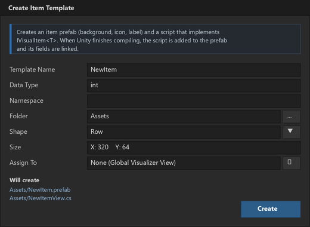

# Global Visualizer (ภาษาไทย)

ระบบแสดงรายการแบบ virtualized สำหรับ Unity uGUI ทั้ง list, grid และ tag flow ใส่ ScrollRect กับ prefab อะไรก็ได้และข้อมูลอะไรก็ได้ ระบบจะสร้างเฉพาะช่องที่มองเห็น แล้วนำ GameObject กลับมาใช้ซ้ำตอนเลื่อน ข้อมูลหมื่นชิ้นใช้ทรัพยากรพอ ๆ กับยี่สิบชิ้น

ผู้สร้าง: **Axnise** · ฉบับภาษาอังกฤษ: [README.md](README.md) · ประวัติการเปลี่ยนแปลง: [CHANGELOG.md](CHANGELOG.md) · สัญญาอนุญาต: MIT

## ความสามารถ

- **prefab อะไรก็ได้ ข้อมูลอะไรก็ได้:** ผูกข้อมูลด้วย callback หรือใส่ `IVisualItem<T>` ไว้บนคอมโพเนนต์ไหนก็ได้ใน prefab ไม่ต้องสืบทอด class ใด
- **Layout:**
  - Vertical
  - Horizontal
  - Grid (Fit / Fixed Columns / Fixed Rows)
  - Flow (ตัดบรรทัดแบบป้าย tag)
- **ขนาดช่อง:**
  - **Fixed:** ทุกช่องขนาดเท่ากัน
  - **Provider:** ขนาดมาจากโค้ด
  - **Measure:** วัดจาก layout ของ prefab หลังผูกข้อมูล
  - Grid ใช้ขนาดช่องเดียวเสมอ
- **ไม่มี GC ตอนเลื่อน:** view ถูก pool และ cache คอมโพเนนต์ไว้
- **การโต้ตอบ:**
  - event คลิก, ดับเบิลคลิก, คลิกขวา และ submit
  - เลือกได้ทีละชิ้นหรือหลายชิ้น (Shift เลือกเป็นช่วง, Ctrl เพิ่มหรือเอาออก)
  - เลื่อนด้วยคีย์บอร์ดหรือจอยผ่าน EventSystem ไปยังช่องที่ยังไม่ถูกสร้างก็ได้
  - **ลากหรือเลื่อน:** ลากขวางแกนเลื่อนเป็นการลากไอเท็ม (ผ่าน `IVisualDragHandler`) ลากตามแกนเป็นการเลื่อนรายการ
  - snap ให้ขอบช่องตรงขอบ viewport (เปิดได้ถ้าต้องการ)
- **Placeholder ตอนว่าง:** แสดงเมื่อกำหนดข้อมูลแล้วแต่ไม่มีรายการ
- **เครื่องมือใน Editor:**
  - คลิกขวาใน Hierarchy > **Global Visualizer > Vertical List / Horizontal List / Grid / Flow (Tags)**
  - Wizard **Create Item Template...** สร้าง prefab พร้อมสคริปต์ `IVisualItem<T>`
  - Preview ใน Edit Mode (ไม่ถูกบันทึกลงฉาก)
  - Gizmo ใน Scene view

## สิ่งที่ต้องมี

- Unity 2022.3 ขึ้นไป
- uGUI (`com.unity.ugui`)
- ไม่บังคับ:
  - Input System สำหรับปุ่ม Shift/Ctrl และ EventSystem ใน sample
  - TextMeshPro ซึ่ง wizard จะใช้ถ้ามีในโปรเจกต์

## ติดตั้ง

เลือกวิธีใดวิธีหนึ่ง:

- **Package Manager > + > Install package from git URL...** แล้วใส่ URL ของโฟลเดอร์ package นี้
- **Package Manager > + > Install package from disk...** แล้วเลือก `package.json`
- คัดลอกโฟลเดอร์ไปไว้ใน `Packages/` ของโปรเจกต์ (embedded package)

จากนั้นไปที่ **Package Manager > Global Visualizer > Samples** แล้ว import **Showcase** เปิด `GlobalVisualizerShowcase.unity` แล้วกด Play ในนั้นมี:

- **Learn:** บทเรียนแบบลองทำ 9 บท แต่ละบทมีเป้าหมายที่ติ๊กเองเมื่อทำได้ พร้อมโค้ดของขั้นนั้น
- **Playground:** ปรับทุกค่าได้สด
- **Benchmark:** เทียบ ScrollRect + LayoutGroup แบบปกติกับ Global Visualizer ด้วยข้อมูลชุดเดียวกัน วัดเวลาสร้าง, จำนวน GameObject, หน่วยความจำ, เวลาต่อเฟรม, การโตของ heap และต้นทุนตอนข้อมูลเปลี่ยน
- **Self Test:** ตรวจคุณสมบัติที่ package สัญญาไว้ใน build ของคุณ

ส่วน **Basic Demo** กับ **Interaction Demo** เป็น sample เล็ก ให้ใส่คอมโพเนนต์ demo บน GameObject เปล่าแล้วกด Play

## เริ่มต้นอย่างเร็ว

1. คลิกขวาใน Hierarchy เลือก **Global Visualizer > Vertical List** จะได้ ScrollRect, `GlobalVisualizerView` และ **Item Template** ที่ปิดไว้

   

2. ถ้าต้องการ prefab ของตัวเอง ให้คลิกขวาอีกครั้งแล้วเลือก **Create Item Template...**

   

3. ผูกข้อมูลจากโค้ด:

```csharp
_view.SetItems(_scores, (go, score, index) => go.GetComponentInChildren<Text>().text = score.Name);
_scores.Add(newScore);
_view.NotifyInserted(_scores.Count - 1, 1);
```

## โหมดขนาดช่อง

- **Fixed:** ทุกช่องใช้ `Item Size` ค่าไหนเป็น 0 จะใช้ขนาดของ prefab แทน โหมดนี้เร็วที่สุด
- **Provider:** กำหนดผ่าน `view.SizeProvider = index => ...` ระบบจะ cache ขนาดไว้ ถ้าขนาดช่องไหนเปลี่ยนให้เรียก `NotifyChanged(i)`
- **Measure:**
  - วัดราก prefab ด้วย `LayoutUtility` หลังผูกข้อมูล รากต้องมี Layout Group, Layout Element หรือ text
  - ช่องที่ยังไม่ได้วัดจะใช้ค่าเฉลี่ยของช่องที่วัดแล้วไปก่อน
  - ช่องแรกที่มองเห็นจะอยู่กับที่ตอนขนาดถูกแก้

## ข้อผิดพลาดที่พบบ่อย

- **ใส่ LayoutGroup หรือ ContentSizeFitter บน Content:** ระบบจะปิดทิ้ง (และเตือน) เพราะคำนวณตำแหน่งเอง ให้ลบออก
- **สร้างรายการใหม่ทุกครั้งที่ข้อมูลเปลี่ยน:** ให้เรียก `Notify*` ครั้งเดียวต่อการเปลี่ยน หรือเรียก `NotifyReset()` ครั้งเดียวหลังเปลี่ยนเป็นชุด
- **เก็บ state ไว้บน view:** view ถูกนำไปใช้กับ index อื่น ให้เก็บ state ไว้ในข้อมูล แล้วนำมาใช้ใน `Bind`
- **ใช้ Measure แต่รากของ prefab ไม่มี layout:** ระบบวัดไม่ได้และจะใช้ค่าประมาณแทน Inspector จะเตือน

## Test

package มี EditMode test อยู่ใน `Tests/Editor` ถ้าจะรันในโปรเจกต์อื่น ให้ใส่ `"testables": ["com.globalvisualizer.core"]` ใน `Packages/manifest.json`
